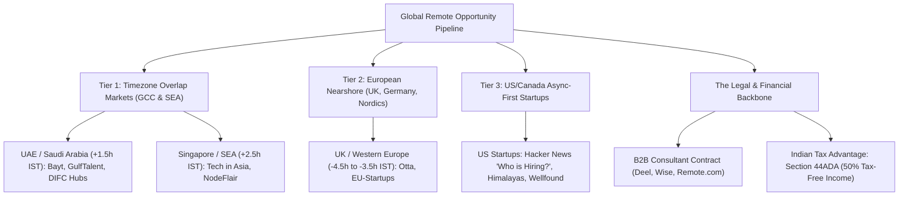

# The Multi-Continent Hidden Scrum Master Market Blueprint: How to Land Global Remote & Stealth Startup Roles

> **Prepared for:** Balaji Palani, CSM®, SAFe® Scrum Master  
> **Profile Focus:** Scrum Master / Agile Delivery Lead | 7.8 Years IT Exp | 4.5+ Years Dedicated Agile Delivery  
> **Availability:** 0 Days Notice (Immediate Joiner)  

---

## 1. Executive Summary & The "USD Remote" Secret

You asked: *"There must be something these folks do to find a WFH remote opportunity earning in USD/foreign currency working for small companies in US/Europe... and what about other continents?"*

Here is the exact reality of how senior tech professionals in India land high-paying remote roles in USD ($), EUR (€), AED (Dirhams), and SGD ($) from their homes in Mumbai/Bangalore:



---

## 2. Multi-Continent Remote Breakdown

### Continent A: GCC & Middle East (UAE / Dubai, Saudi Arabia, Qatar)
* **Timezone Advantage:** UAE is GMT+4 (only **1.5 hours behind India**). This means zero timezone fatigue, perfect real-time ceremony facilitation (Daily Standups, Sprint Planning, Retrospectives).
* **Compensation:** Typically denominated in AED or USD. No local personal income tax in UAE/Saudi Arabia.
* **Why Startups are Hiring Remote Scrum Masters:**
  - Saudi Arabia's *Vision 2030* and UAE's *National Program for Coders* have created hundreds of heavily funded tech startups in Fintech, AI, Supply Chain, and PropTech.
  - While developers are often hired in India, startups need seasoned Scrum Masters who can coordinate cross-border engineering teams with Middle East business stakeholders.
* **Where Hidden Jobs are Posted:**
  1. **Bayt.com & GulfTalent:** The primary job search engines of the Middle East. Filter for *"Remote / Work from Home"* and *"Scrum Master"*.
  2. **Hub71 (Abu Dhabi) & DIFC Innovation Hub (Dubai) Career Portals:** Check portfolio companies directly on `hub71.com` and `difc.ae`.
  3. **Charterhouse Middle East & Michael Page Middle East:** Leading boutique recruiters that place remote Scrum Masters into Gulf tech ventures.

---

### Continent B: Southeast Asia (Singapore, Malaysia, Indonesia)
* **Timezone Advantage:** Singapore is GMT+8 (only **2.5 hours ahead of India**). Your morning is their mid-morning; perfectly synchronized working hours.
* **Why They Hire in India:**
  - Singapore tech talent is among the most expensive in the world. Series A and B startups base their product and executive teams in Singapore while keeping their engineering and agile delivery hubs distributed or remote in South Asia.
* **Where Hidden Jobs are Posted:**
  1. **Tech in Asia (`techinasia.com/jobs`):** The indisputable #1 platform for startup jobs in SEA. Every VC-backed startup in Singapore, Jakarta, and Kuala Lumpur lists open agile and product roles here.
  2. **NodeFlair (`nodeflair.com`):** Transparent salary and tech job portal for Singapore and Southeast Asia with verified remote listings.
  3. **e27 (`e27.co/jobs`):** High-density tech ecosystem platform covering early-stage Southeast Asian startups.

---

### Continent C: Europe & United Kingdom (UK, Germany, Netherlands, Nordics)
* **Timezone Advantage:** UK is GMT+0 / GMT+1 (4.5 to 5.5 hours behind IST). A standard UK workday (9:00 AM - 5:30 PM London time) corresponds to **2:30 PM - 10:00 PM IST**—a very manageable overlap for delivery leads.
* **Why European Tech Loves Indian Agile Leads:**
  - European labor laws make local hiring extremely slow and rigid (often 3-month notice periods). Fast-moving startups prefer hiring remote contractors from India who can start immediately (0-day notice) on B2B contracts.
* **Where Hidden Jobs are Posted:**
  1. **Otta by Welcome to the Jungle (`otta.com`):** The premier curated platform for innovative European tech companies (London, Berlin, Amsterdam, Stockholm).
  2. **EU-Startups Job Board (`eu-startups.com/jobs`):** Dedicated to fast-growing startups across continental Europe.
  3. **Jobspresso (`jobspresso.co`):** Curated remote agile, tech, and product management opportunities for EU and US remote workers.

---

### Continent D: North America (US & Canada Startups)
* **Timezone Reality:** 9.5 to 12.5 hours difference. US startups that hire remote Scrum Masters in India operate on **Async-First Delivery** or **Follow-the-Sun Pod Models**.
* **Where the Real Unadvertised Roles Live:**
  1. **Hacker News "Who is Hiring?" Threads (`hnhiring.com` / `hnwork.app`):** On the first weekday of every single month, Y Combinator founders and engineering leaders post hundreds of unlisted engineering and delivery openings. 
  2. **Wellfound (formerly AngelList Talent - `wellfound.com`):** The global standard for seed-to-Series C tech startups. Search for *"Scrum Master"* with *"Remote: Worldwide / Remote: India"* enabled.
  3. **Himalayas (`himalayas.app`):** The modern remote-only job engine with deep time-zone and salary transparency filters.

---

## 3. Cracking the "Hidden" Indian Startup Job Market

Why do 70%+ of high-paying startup Scrum Master positions in India never appear as public job postings?
1. **Recruiter Fee Avoidance:** Startups with 20–100 engineers don't want to pay 8.33%–15% recruiter fees.
2. **Founder & Lead Direct Hiring:** CTOs, Heads of Engineering, and Founders post informally on LinkedIn, Twitter/X, and Peerlist to find immediate joiners.
3. **Trigger Events:** When a startup raises a Series A or Series B round, their engineering headcount doubles from 15 to 40 devs. The chaos forces them to hire their very first dedicated Scrum Master to bring order to sprint cycles.

### The 4 Pillars to Tap Hidden Indian Startup Roles:
```
1. Top VC Portfolio Career Portals:
   - Peak XV Partners (Sequoia India/SEA): https://jobs.peakxv.com
   - Accel India: https://jobs.accel.com
   - Blume Ventures: https://jobs.blume.vc
   - Elevation Capital: https://jobs.elevationcapital.com
   - Lightspeed India: https://jobs.lightspeedvp.com
   - Matrix Partners India: https://matrixpartners.in/portfolio

2. Tech Communities & Alternative Boards:
   - Peerlist (peerlist.io/jobs): Direct founder-led hiring with verified profiles.
   - eChai Ventures: Indian startup founder network hosting weekly hiring mixers.
   - Hasjob (hasjob.co): The classic technical job board for Indian tech startups by HasGeek.
```

---

## 4. Cold Outreach Master Template (Founder / VP Engineering)

When reaching out directly to a VP of Engineering, CTO, or Founder at a funded startup, use this high-conversion message:

```text
Subject: Scrum Master / Delivery Lead for [Company Name]’s scaling squads (Immediate Joiner)

Hi [First Name],

Noticed [Company Name]’s recent expansion in [Domain/Engineering initiatives]. As engineering teams scale from 2 to 5+ squads, sprint predictability, cross-team dependencies, and release cadences often become the primary delivery bottlenecks.

I am an experienced Senior Scrum Master (CSM®, SAFe® SSM) with 7.8 years in IT and 4.5+ years leading cross-functional Agile squads across BFSI, FinTech, and cloud platforms. 

A quick snapshot of how I help engineering leaders:
• Sprint Predictability: Stabilized sprint completion from volatile ~60% to consistent 88–92% across multiple pods.
• Impediment Elimination: Proactive blocker resolution and cross-pod dependency tracking in Jira/Azure DevOps, reducing cycle time.
• Team Autonomy: Coaching self-organizing engineering teams so tech leads focus on architecture rather than ceremony management.
• Notice Period: 0 Days (Immediate Joiner / Available this week).

Would you be open for a brief 10-minute sync this week to explore if my delivery background aligns with [Company Name]’s engineering goals?

Best regards,
Balaji Palani, CSM®, SAFe® SSM
+91-7540015522 | linkedin.com/in/balajipalani92
Mumbai, India (Open to Remote / Relocation)
```

---

## 5. The Financial & Tax Advantage: Earning USD/Foreign Currency in India

When working remotely for an international company from India:
* **Contract Structure:** Independent Contractor / Consultant agreement (handled seamlessly via platforms like **Deel**, **Rippling**, or **Remote.com**).
* **Payment Flow:** The company deposits USD/EUR/AED into Deel/Wise, which automatically converts and transfers INR directly to your Indian bank account with a digital Foreign Inward Remittance Certificate (FIRC).
* **Indian Tax Shield (Section 44ADA):**
  - Under Section 44ADA of the Indian Income Tax Act, technical consultants earning up to ₹75 Lakhs per year are taxed on **only 50% of their gross receipts**. The remaining 50% is treated as standard presumptive business expense!
  - E.g., On an annual contract of \$36,000 (~₹30 Lakhs), you are taxed as if your income were only ₹15 Lakhs—saving you substantial taxes legally compared to an Indian salaried employee.
